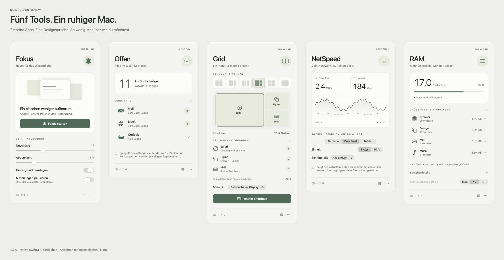

# Mac Tools

Fünf einzelne, native Mac-Apps. Eine gemeinsame Designsprache. Lokale Verarbeitung, ohne Konto.

**Entwicklungsstand 0.3.0 · Vorschau zum Selbstbauen, noch kein stabiler App-Release.**

[Website](https://tools.gholding.at) · [Quellcode](https://github.com/michaelgrafenberger/mac-tools) · [MIT-Lizenz](LICENSE)

| App | Aufgabe | Standard-Tastenkürzel |
| --- | --- | --- |
| Fokus | Hintergrundfenster abdunkeln und weichzeichnen; optional macOS-Fokus über eigene Kurzbefehle | ⌘ ⇧ F: Fokus umschalten |
| Offen | Dock-Badges laufender Apps in einer Übersicht bündeln und Apps direkt öffnen | ⌃ ⌥ O: Übersicht öffnen |
| Grid | Fenster auf sechs visuelle Layouts verteilen, per Klick oder Drag-and-drop zuordnen und die letzte Anordnung rückgängig machen | ⌃ ⌥ G: Übersicht öffnen |
| NetSpeed | Aktuellen Download und Upload mit einem 60-Sekunden-Verlauf anzeigen | ⌃ ⌥ N: Übersicht öffnen |
| RAM | Speicherauslastung und nach Speicher sortierte Apps/Prozesse; gezieltes Beenden | ⌃ ⌥ R: Übersicht öffnen |



## Selbst bauen

Voraussetzungen: macOS 13 oder neuer und Xcode Command Line Tools mit Swift 5.7 oder neuer. Nur AppKit, SwiftUI und mit macOS gelieferte Frameworks; keine Paketabhängigkeiten.

```bash
bash Scripts/build.sh
```

Einzelne App bauen:

```bash
bash Scripts/build.sh Grid
```

Die fertigen Apps liegen unter `Build/`. Das Skript **installiert oder startet nichts**, beendet keine Prozesse und verändert keine bestehende Installation. Bei Erfolg wird lokal ad hoc signiert und die Signatur geprüft. Die Bundle-IDs `at.grafenberger.tools.*` unterscheiden sich von den mitgelieferten älteren Apps. Die beiden Generationen sollten wegen möglicher Tastenkürzelkonflikte nicht gleichzeitig verwendet werden.

Zum Ausprobieren eine App in `Build/` per Finder öffnen. Dauerhafte Installation durch Verschieben nach Programme. Eine spätere Installation sollte eine eventuell bereits dort vorhandene Version bewusst ersetzen.

Der Build verwendet standardmäßig die Architektur des aktuellen Macs. Optional:

```bash
ARCH=x86_64 BUILD_OUTPUT="$PWD/Build/Intel" bash Scripts/build.sh
```

Die Mindestversion ist ein Build-Ziel, keine Zusage über bereits getestete ältere macOS-Versionen. Den tatsächlichen Prüfstand dokumentiert [VALIDATION.md](VALIDATION.md).

## Wenig Platz in der Menübar

Alle Apps haben dieselben Einstellungen hinter dem Schieberegler-Symbol:

- Icon in der Menübar ein- oder ausblenden.
- Bei Anmeldung starten; bei Bedarf mit Bestätigung in macOS-Anmeldeobjekten.
- Drei Tastenkürzel-Kombinationen pro App wählen.

Ohne Icon bleiben Offen, Grid, NetSpeed und RAM per Tastenkürzel erreichbar. Bei Fokus schaltet das Tastenkürzel den Fokus direkt um. Zum Öffnen der Fokus-Einstellungen ohne Icon die App erneut im Finder oder über Spotlight öffnen. Erneutes Öffnen startet keine zweite Instanz.

Ist ein Tastenkürzel bereits belegt, erscheint eine Fehlermeldung und das Menübar-Icon bleibt erreichbar. NetSpeed bietet zusätzlich „Nur Icon“, „Download“ und „Beide“ als Anzeigevarianten. Wer alle Icons ausblendet, belegt mit diesen Tools keinen dauerhaften Menübar-Platz.

## Hinweise zu den Apps

### Fokus

Unschärfe und Abdunklung lassen sich getrennt einstellen. Die präzise Unschärfe nutzt wie die Originalversion eine private WindowServer-Funktion. Wenn diese fehlt oder fehlschlägt, wird ein öffentlicher AppKit-Materialeffekt verwendet; dessen Aussehen und Stärke sind systemabhängig. Deshalb ist die App derzeit nicht als für alle macOS-Versionen geprüft einzustufen.

„Mitteilungen pausieren“ ist standardmäßig aus. Wer die Funktion nutzen möchte, erstellt in Apples Kurzbefehle-App zwei Kurzbefehle mit exakt diesen Namen:

- `Fokus an`: Aktion „Fokus festlegen“, um den gewünschten macOS-Fokus einzuschalten.
- `Fokus aus`: den entsprechenden Fokus wieder ausschalten.

Fehlende oder fehlschlagende Kurzbefehle werden angezeigt. Beim regulären Beenden wird ein gegebenenfalls angeforderter Fokus wieder ausgeschaltet. Nach einem erzwungenen Prozessabbruch ist dies nicht möglich. Die Kurzbefehle bestimmen das Verhalten; die App speichert und restauriert keinen vorherigen macOS-Fokus.

### Offen

Liest ausschließlich Dock-Badge-Labels über das mit macOS gelieferte `lsappinfo`. Keine Mail- oder Slack-Anmeldung und kein Lesen von Nachrichteninhalten. Ein Badge ist nicht automatisch die Zahl ungelesener Nachrichten. `99+` bleibt als Untergrenze sichtbar; Punkte werden als Aktivität angezeigt. Nicht lesbare Badges ergeben einen Hinweis und werden nicht als „alles erledigt“ ausgegeben.

Slack, Mail, Outlook und Spark bleiben sichtbar, solange sie laufen. Andere Apps erscheinen bei Badge-Aktivität. ClickUp, Systemeinstellungen und App Store sind wie in der gelieferten Version ausgeschlossen. Weitere Apps lassen sich per Kontextmenü ausblenden und über den eingeblendeten Wiederherstellen-Link zurückholen.

### Grid

Fordert die Bedienungshilfen-Freigabe erst nach einem Klick auf „Bedienungshilfen erlauben“ an. Ohne diese Freigabe lassen sich fremde Fenster nicht zuverlässig bewegen. Keine Bildschirmaufnahme: Die Zuordnung verwendet App-Icons, Fenstertitel und Geometrie.

1. Layout wählen.
2. Feld wählen und ein Fenster in der Liste anklicken oder ins Feld ziehen. „Auto“ belegt die Felder in der aktuellen Fensterreihenfolge.
3. Bildschirm und Abstand wählen und „Fenster anordnen“ drücken.
4. Die letzte Anordnung lässt sich beim erneuten Öffnen rückgängig machen.

Es werden sichtbare, verschiebbare und skalierbare Fenster auf dem aktuellen Schreibtisch angeboten. Minimierte, ausgeblendete und echte Vollbildfenster sowie Fenster auf anderen Spaces werden nicht automatisch eingesammelt. Manche Apps haben Mindestgrößen oder eigene Fensterregeln. Grid überprüft die tatsächliche Zielgeometrie und meldet teilweise fehlgeschlagene Anordnungen. Gespeicherte Arbeitsumgebungen und das Wiederöffnen von Dokumenten sind noch nicht enthalten.

### NetSpeed

Verwendet lokale 64-Bit-Netzwerkzähler und tatsächliche Messintervalle. WLAN-/Ethernet-artige `en*`- und `pdp_ip*`-Schnittstellen werden unterstützt. VPN-Tunnel, Loopback und Peer-to-peer-Interfaces werden nicht zusätzlich summiert. Alle aktiven unterstützten Schnittstellen oder eine bestimmte Schnittstelle können ausgewählt werden.

Die Anzeige misst aktuell übertragenen Verkehr, auch im lokalen Netzwerk. Sie misst nicht die maximal verfügbare Internetgeschwindigkeit. Dezimale Byte- oder Bit-Einheiten, ein Verlauf der letzten 60 Messungen und eine feste Menübar-Breite vermeiden springende Anzeigen. Nach Sleep und bei zurückgesetzten Zählern wird eine neue Basis gebildet.

### RAM

Zeigt benutzten Speicher, Speicherdruck, Cache, komprimierten Speicher und Swap. Die größten Prozesse des aktuellen Benutzers werden nach physischem Speicher-Footprint sortiert; App-Helfer werden gebündelt. Die Prozessliste wird beim Öffnen und nach manueller Aktualisierung neu gelesen. Die Gesamtauslastung wird alle zwei Sekunden aktualisiert.

Ein Klick auf einen Eintrag öffnet dessen Aktionen. „Beenden“ fordert Apps regulär zum Schließen auf, damit sie gegebenenfalls nach dem Speichern fragen können. „Sofort beenden“ verlangt eine zusätzliche ausdrückliche Bestätigung. Systemkritische Prozesse und das Tool selbst werden ausgeschlossen. Benutzerkennung und Prozessstartzeit werden vor Signalen erneut geprüft, damit wiederverwendete PIDs nicht versehentlich einen neuen Prozess treffen. Es werden keine Administratorrechte angefordert.

Menübar-Anzeige als Icon, Prozent oder GB; das Icon lässt sich wie bei den anderen Tools ganz ausblenden. Ein hoher Prozentwert allein ist kein zuverlässiger Hinweis auf einen Engpass. App-Footprints können gemeinsame Speicherbereiche enthalten und lassen sich nicht zur physischen Gesamtsumme addieren. Die App verspricht keine künstliche „RAM-Bereinigung“.

## Entwicklung und Prüfungen

```bash
bash Scripts/test.sh --network
bash Scripts/test-native.sh
bash Scripts/test-ram.sh
bash Scripts/render-previews.sh
```

Die nativen Tests benötigen eine normale grafische Mac-Sitzung. Sie erzeugen nur eigene Testfenster und einen eigenen Dock-Badge. Fensterbewegungen werden nur mit bereits vorhandener Bedienungshilfen-Freigabe geprüft; der Test fordert keine neue Freigabe an. Vorschau-Screenshots verwenden ausdrücklich als Vorschau markierte Beispieldaten, keine Kundendaten.

Die gemeinsamen Farben, Typografie und Bausteine liegen in `Sources/Shared/Design.swift`. [DESIGN.md](DESIGN.md) beschreibt die Gestaltung. `Scripts/make-icons.swift` erzeugt die zugehörigen gezeichneten App-Icons; fertige Icons liegen in `Assets/`.

## Lizenz und Release-Status

Die Sammlung wird unter der [MIT-Lizenz](LICENSE) veröffentlicht. Sie erlaubt Nutzung, Änderungen und Weitergabe unter Beibehaltung des Lizenz- und Copyright-Hinweises. Für fertige App-Downloads fehlen Developer-ID-Signierung, Notarisierung und zusätzliche Tests auf den tatsächlich unterstützten macOS-Versionen. Das vorhandene Ad-hoc-Signing ist für lokale Builds gedacht.

Die Landingpage unter [tools.gholding.at](https://tools.gholding.at) zeigt die Sammlung. Die fünf Apps teilen sich dieses Repository und sind einzeln baubar. Ein öffentlicher Download fertiger, notarisiert verteilter Apps ist noch nicht enthalten.
